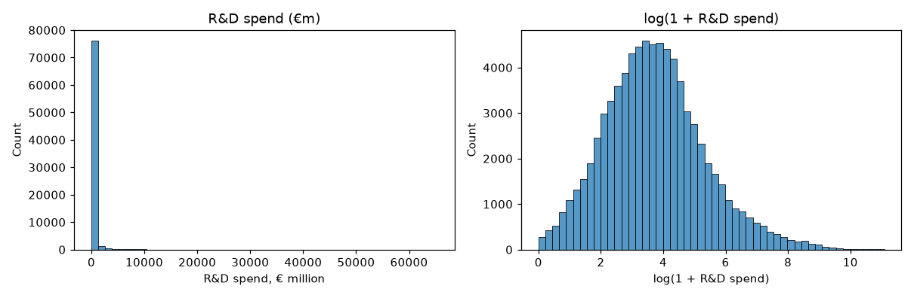
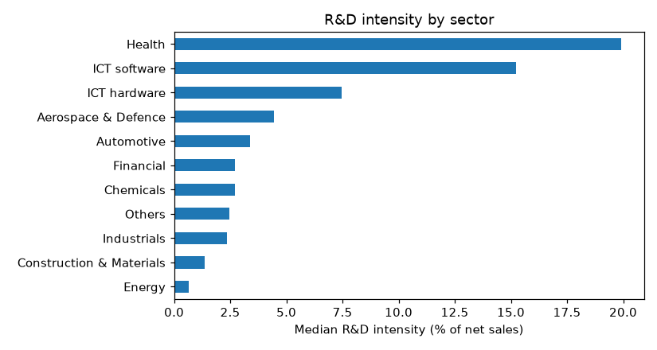
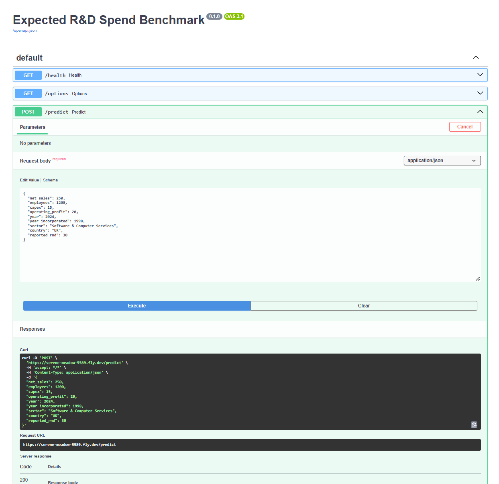
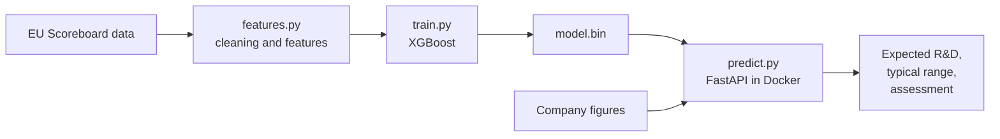

# Expected R&D Spend Benchmark

Midterm project for the DataTalksClub [Machine Learning Zoomcamp 2026](https://github.com/DataTalksClub/machine-learning-zoomcamp).

A machine learning model and web service that estimates the R&D spend you'd expect from a company, given its size, sector, profitability and location, and flags reported R&D figures that look unusually high or low.

**Results at a glance:** XGBoost, trained on about 78,000 records from the EU Industrial R&D Investment Scoreboard, predicts R&D spend for companies it has never seen to within a typical factor of 2.2 (test RMSE 0.780 on log R&D). It is served with FastAPI and packaged with Docker.

## Evaluation

The self-assessment against each of the course's evaluation criteria is in [docs/project-evaluation.md](docs/project-evaluation.md).

## Problem description

Companies in the UK can claim tax relief on qualifying research and development (R&D) spend. Advisers who prepare and review these claims, and HMRC when it checks them, often ask a simple sense-check question: **is this company's R&D figure in line with what we'd expect for a business of its size and type?**

Today that judgement is mostly based on experience. This project builds a model that answers it with data. Given a company's:

- size (net sales, employees, capital expenditure)
- profitability (operating profit)
- sector and location
- age

the model predicts the R&D spend you'd **expect** for that profile. Comparing a company's actual R&D with the prediction shows whether it is typical, unusually high or unusually low, which flags figures worth a closer look.

**How it would be used:** an adviser reviewing a claim enters the company's figures from its accounts, together with the R&D spend being claimed. The service returns the expected R&D for a company of that profile, a typical range, and an assessment. A figure well outside the range doesn't mean a claim is wrong, but it is a prompt to check the claim more closely before it is submitted, and a way to spot claims likely to attract questions. Every input is a figure found in a company's annual accounts, so the tool works for private as well as listed companies.

The model is trained on the world's largest corporate R&D investors, so it is a proof of concept rather than a tool for small-company claims. The same approach could be applied to other company-level data (see [Limitations and next steps](#limitations-and-next-steps)).

## Dataset

The [EU Industrial R&D Investment Scoreboard](https://knowledge-for-policy.ec.europa.eu/publication/2025-eu-industrial-rd-investment-scoreboard-0_en), published annually by the European Commission's Joint Research Centre, ranks the companies investing most in R&D worldwide. This project uses the **2025 Scoreboard panel**, which tracks these companies from 2003 to 2024:

- about 97,000 company-year rows covering about 6,300 companies
- all money values converted to 2024 euros (€ million)

The original 41 MB spreadsheet has 57 columns. The project uses a trimmed copy with the 14 columns needed, committed at [`data/scoreboard_panel.csv`](data/scoreboard_panel.csv).

| Column | Meaning |
|---|---|
| `company`, `company_name` | Short and long company name |
| `year` | Financial year |
| `new_country`, `region_12_new` | Country and world region of headquarters |
| `icb3_short`, `icb3_name` | Sector: 11 broad groups and 39 detailed sectors |
| `rnd_24` | **Target:** R&D investment (€m) |
| `netsales_24`, `capex_24`, `profit_24`, `mcap_24` | Net sales, capital expenditure, operating profit, market capitalisation (€m) |
| `emp` | Number of employees |
| `year_inc_new` | Year of incorporation |

The ranking columns in the original file are left out on purpose. They are calculated from R&D spend, so using them as features would leak the answer into the model.

To rebuild the CSV from the original source:

```bash
uv run python prepare_data.py
```

If the download fails, download the "2025 Scoreboard Panel" file manually from the page linked above and run `uv run python prepare_data.py path/to/file.xlsx`.

## Exploratory data analysis

The full analysis is in sections 2 and 3 of [`notebook.ipynb`](notebook.ipynb). Key findings:

**Data quality**
- 18.6% of rows have no R&D figure and 228 have zero R&D; these can't be used and were dropped.
- Some values are impossible and were traced to their cause. The largest net sales figure (€50 trillion, Ecopetrol, 2015) is in Colombian pesos but labelled as US dollars in the source data, so it was converted at the wrong exchange rate.
- A sense-check of R&D spend per employee found 68 rows with contradictory figures (over €5m per employee, against a typical €11,000), such as a small UK tidal energy company reporting €3.3bn of R&D with 33 staff. These were dropped.
- Negative sales and capex, and zero employee counts, were treated as missing values. After cleaning, 78,501 rows from 6,295 companies remain.

**The target**



R&D spend is extremely skewed: the median company spends €37m a year, but a few spend tens of billions (Amazon: €65bn in 2024). After a log transform the distribution is close to bell-shaped, so the model predicts log R&D. Net sales, employees and capex are skewed in the same way and are also log-transformed.

**Sector matters relative to size**



R&D intensity (R&D as a percentage of sales) varies about 30-fold between sectors, from 0.7% in Energy to 20% in Health. In 6.6% of rows a company spends more on R&D than its total sales, mostly biotech companies investing before they have products on the market; a quarter of all rows are loss-making, rising to 55% in Health.

**Feature importance**
- Company size is the strongest predictor of R&D (correlation with log R&D: 0.59 to 0.73 for sales, employees, capex and market value). The size features overlap heavily (sales and employees: 0.92).
- On its own, sector says little about the *amount* of R&D (mutual information 0.05), but it is the strongest categorical predictor of R&D *intensity* (0.43 for the 39 detailed sectors). Sector tells you how much a company spends *for its size*, so the model needs size and sector together.

## Model training

The full work is in sections 4 to 6 of [`notebook.ipynb`](notebook.ipynb), and the final model is trained by [`train.py`](train.py).

**Features:** log net sales, log employees, log capex, profit margin, company age, year, detailed sector (39 categories) and country. Left out deliberately:
- **market capitalisation:** a strong predictor, but only listed companies have one, and most companies claiming R&D tax relief are private
- **company name:** the model would memorise companies rather than learn general patterns
- **R&D intensity and the Scoreboard rankings:** calculated from R&D spend, so they would leak the answer

**Validation approach:** each company appears in the data for 12 years on average, so a random split would put different years of the same company in both the training and test sets and give an over-optimistic score. The data is therefore split **by company**: 60% of companies for training, 20% for validation and 20% for testing. The test score measures performance on companies the model has never seen, which matches the intended use.

**Models:** four models were trained and tuned on the training set and compared on the validation set. The metric is RMSE on log R&D; `exp(RMSE)` gives the typical factor by which predictions are off.

| Model | Parameters tuned | Best settings | Validation RMSE | Typical error |
|---|---|---|---|---|
| Baseline (always predict the average) | – | – | 1.592 | × 4.9 |
| Ridge regression | `alpha` | alpha 1 | 0.917 | × 2.50 |
| Decision tree | `max_depth`, `min_samples_leaf` | depth 12, leaf 50 | 0.939 | × 2.56 |
| Random forest | `n_estimators`, `max_depth`, `min_samples_leaf` | 100 trees, no depth limit, leaf 5 | 0.843 | × 2.32 |
| **XGBoost** | `eta`, number of rounds, `max_depth`, `min_child_weight` | eta 0.1, 240 rounds, depth 6, min_child_weight 1 | **0.795** | **× 2.21** |

The tree ensembles clearly beat the linear model, consistent with the EDA finding that sector matters in combination with company size. XGBoost's most important features are net sales, followed by country (US) and a range of sectors.

**Final model:** XGBoost, retrained on the training and validation companies together and evaluated once on the test set:

- **Test RMSE: 0.780** (typical error × 2.18), in line with validation, so the model generalises to new companies.
- 74% of test predictions are within the typical range.
- Example: GSK (2024) reported R&D of €6,866m against a predicted €4,336m, higher than expected for a pharmaceutical company of its size but within the typical range.

## Running the project

### Requirements

- Python 3.11
- [uv](https://docs.astral.sh/uv/) for dependency and virtual environment management
- Docker (for the web service)

### Set up the environment

```bash
pip install uv          # if uv isn't installed already
uv sync                 # creates .venv and installs the exact versions in uv.lock
```

Commands need to run inside the virtual environment (`.venv`). There are two equivalent ways to do this.

**Option 1:** prefix each command with `uv run`:

```bash
uv run jupyter notebook
```

**Option 2:** activate the environment once per terminal session, then run commands as normal:

```bash
source .venv/bin/activate
jupyter notebook
```

When the environment is active, the terminal prompt starts with `(rd-spend-benchmark)`. Run `deactivate` to leave it.

If you're using GitHub Codespaces, VS Code forwards Jupyter's port 8888 automatically: open it from the **Ports** panel.

### Train the model

```bash
uv run python train.py
```

This cleans the data, splits it by company, reports the validation and test scores, and saves the trained model to `model.bin`. The cleaning and feature engineering code is shared with the web service in `features.py`. A trained `model.bin` is already committed, so this step is optional.

### Run the web service

The model is served with [FastAPI](https://fastapi.tiangolo.com/) on port 9696.

**With Docker (recommended):**

```bash
docker build -t rd-spend-benchmark .
docker run -it --rm -p 9696:9696 rd-spend-benchmark
```

**Without Docker:**

```bash
uv run uvicorn predict:app --host 0.0.0.0 --port 9696
```

### Use the web service

With the service running, send an example request from a second terminal:

```bash
uv run python test_predict.py
```

or with `curl`:

```bash
curl -X POST http://localhost:9696/predict \
  -H "Content-Type: application/json" \
  -d '{"net_sales": 250, "employees": 1200, "capex": 15, "operating_profit": 20,
       "year": 2024, "year_incorporated": 1998,
       "sector": "Software & Computer Services", "country": "UK",
       "reported_rnd": 30}'
```

Example response:

```json
{
  "expected_rnd": 36.94,
  "typical_range": [16.93, 80.62],
  "units": "€ million",
  "reported_rnd": 30.0,
  "reported_vs_expected": 0.81,
  "assessment": "typical"
}
```

| Field | Meaning |
|---|---|
| `expected_rnd` | The model's estimate of R&D spend for a company with this profile (€m) |
| `typical_range` | The range within which predictions are typically accurate (expected ÷ and × the model's typical error factor from the test set) |
| `reported_vs_expected` | Reported R&D divided by expected R&D (only if `reported_rnd` is given) |
| `assessment` | `typical` if the reported figure is within the typical range, otherwise `unusually high` or `unusually low` |

All money values are in € million. Only `year`, `sector` and `country` are required; missing figures are filled with typical values from the training data. Predictions are most reliable when all the financial figures are supplied, because the typical values may not suit a company that is much larger or smaller than average. Valid sectors and countries are listed at `GET /options`, and `GET /health` confirms the service is running. FastAPI also provides interactive documentation at http://localhost:9696/docs.

## Cloud deployment

The service is deployed to [Fly.io](https://fly.io), following the approach in the course's [Module 5 workshop](https://github.com/DataTalksClub/machine-learning-zoomcamp/blob/main/05-deployment/workshop/README.md). Fly.io builds the same Docker image from the `Dockerfile` and runs it in the cloud. The settings are in [`fly.toml`](fly.toml):

- region: London (`lhr`)
- one small machine (shared CPU, 512 MB memory)
- the machine stops automatically when idle and restarts on the next request, so the first request after a quiet period can take a few seconds
- Fly.io checks `/health` to confirm the service is running

**Deployed URL:** https://serene-meadow-5589.fly.dev (interactive documentation at [`/docs`](https://serene-meadow-5589.fly.dev/docs))



**Web app:** a simple web form that uses the deployed service is available at https://rd-spend-benchmark.streamlit.app, built with Streamlit (code in a [separate repository](https://github.com/song2siren/ml-zoomcamp-rd-spend-benchmark-ui)).

### Deploying it yourself

1. Install the Fly.io command-line tool and create an account (new accounts get a short free trial):

   ```bash
   curl -L https://fly.io/install.sh | sh
   export PATH="$HOME/.fly/bin:$PATH"
   fly auth signup        # or: fly auth login
   ```

2. Create the app from the settings in `fly.toml`, with a generated name and a single machine:

   ```bash
   fly launch --copy-config --generate-name --ha=false --no-deploy
   ```

3. Build and deploy:

   ```bash
   fly deploy --ha=false
   ```

   The output ends with the app's address, for example `https://<app-name>.fly.dev`.

4. Test it:

   ```bash
   uv run python test_predict.py https://<app-name>.fly.dev
   ```

   or open `https://<app-name>.fly.dev/docs` in a browser.

5. When you no longer need it, delete the app so nothing further is charged:

   ```bash
   fly apps destroy <app-name>
   ```

## Project structure

```
├── data/scoreboard_panel.csv   # trimmed dataset (committed)
├── docs/project-evaluation.md  # self-assessment against the course criteria
├── images/                     # charts used in this README
├── notebook.ipynb              # data cleaning, EDA, model selection and tuning
├── prepare_data.py             # rebuilds the CSV from the original EU spreadsheet
├── features.py                 # cleaning and feature engineering, shared by training and the service
├── train.py                    # trains the final model and saves model.bin
├── model.bin                   # trained model
├── predict.py                  # FastAPI web service
├── test_predict.py             # example request to the service
├── Dockerfile                  # container for the web service
├── .dockerignore               # files left out of the container
├── fly.toml                    # Fly.io cloud deployment settings
├── pyproject.toml, uv.lock     # dependencies
└── .python-version             # Python version used by uv
```



## Limitations and next steps

**Limitations**
- **Large companies only.** The Scoreboard covers the world's top R&D investors. Small and medium-sized companies, which make most R&D tax relief claims, may follow different patterns, so the model shouldn't be used to judge an individual SME's claim.
- **Wide margin of error.** Predictions are typically off by a factor of about 2. The service shows a typical range rather than a single figure for this reason, and an "unusual" assessment is a prompt to look more closely, not evidence of a problem.
- **Data quality.** Some errors in the source data were found and removed, but others may remain.
- **Different definitions.** The Scoreboard records R&D as reported in company accounts, which is not the same as qualifying expenditure under the UK's R&D tax relief rules.
- **No access control.** The service is open to anyone who can reach it. A real internal tool would need authentication and should not receive confidential client data unless it runs within the firm's own systems.

**Next steps**
- Retrain on data closer to the intended use, such as anonymised historic claim data, used internally with appropriate data governance.
- Develop the [web app](https://rd-spend-benchmark.streamlit.app) further for non-technical users: fuller guidance on interpreting the results and, for any internal use, authentication and hosting within the firm's own systems.
- Apply the same approach to related problems, such as estimating how likely and how soon a patent application is to be granted (relevant to Patent Box), or the chances of success of a grant application.

## Acknowledgements

Data: European Commission, Joint Research Centre, EU Industrial R&D Investment Scoreboard 2025.

Thanks to [DataTalksClub](https://github.com/DataTalksClub) and Alexey Grigorev for the Machine Learning Zoomcamp.
